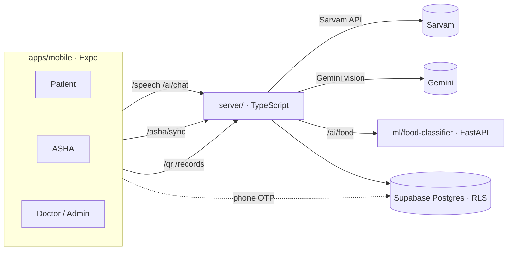

# Aroghya Mitra

One app for three people who rarely share a screen: the **patient** at home, the
**ASHA worker** walking between households, and the **doctor or admin** at the
primary health centre. Hindi, Kannada, Tamil, Telugu, Urdu, Kashmiri and
English; voice first; works offline in the field.

Built for a hackathon by four teams, now joined into one Expo app, one
TypeScript server and one Python food-recognition service.

```
                 ┌──────────────── apps/mobile (Expo, iOS + Android + web) ────────────────┐
                 │  (auth) language · role · OTP  │ (patient) │ (asha) │ (doctor / admin)  │
                 └───────────────┬────────────────┴─────┬─────┴───┬────┴─────────┬─────────┘
                                 │ @am/shared types, theme, i18n │ @am/patient-ai │ @am/records
                                 ▼                               ▼                ▼
               ┌──────────── server/ (TypeScript, web-standard handlers) ─────────────┐
               │ /speech/stt /speech/tts /ai/chat   Sarvam (key stays here)           │
               │ /ai/prescription  /ai/food         Gemini vision · DishDetect proxy  │
               │ /asha/sync /asha/photos            risk re-verified with server/risk │
               │ /qr/issue /qr/scan  /records/*     signed QR health card, history    │
               └───────┬───────────────────────────────────────────────┬──────────────┘
                       ▼                                               ▼
            supabase/migrations (Postgres + RLS)         ml/food-classifier (FastAPI, PyTorch)
```



## What is in the box

| Role | Screens | Logic it runs on |
|---|---|---|
| Patient | Home with service tiles and "Call 108" · AI chat (streamed, red-flag banner) · voice assistant · prescription explainer · reminders with Taken / Skip and streak · nutrition scan with portion slider · QR health card · history · report upload · blood banks · hospital navigation | `packages/patient-ai` (red flags, reminder schedule, adherence, macros), `packages/records`, `server/ai` |
| ASHA worker | Caseload · register patient · patient detail · home visit with voice report · alerts · referrals · offline outbox with sync | `apps/mobile/features/asha` (35-rule risk engine), `server/asha` re-verifies every alert |
| Doctor / Admin | Dashboard with Scan QR · patients · consultation with prescription (lands in the patient's reminders) · referral inbox fed by ASHA referrals · admin: users, ASHA assignments, blood stock, analytics | `packages/records` (dashboard, inbox, analytics), `server/qr`, `server/records` |

Everything the four modules share lives in `packages/shared`: the types, the
theme tokens, the language table and the **demo cast**, so the pregnant patient
with high blood pressure in Sunita's caseload (Rekha Kumari) is the same person
who signs in as the patient, whose QR the doctor scans, and whose referral sits
in Dr Rao's inbox.

## Setup

```bash
# Node 24+ and npm 11; Python 3.11+ only for the food model
npm install                       # installs the app, packages and server (npm workspaces)
cp .env.example .env              # server secrets: SARVAM_API_KEY, GEMINI_API_KEY, QR_TOKEN_SECRET
cp apps/mobile/.env.example apps/mobile/.env   # app settings (no keys in here, ever)

npm test                          # server + packages (node --test) and the app (jest-expo)
npm run typecheck                 # server/packages tsconfig + the app's
npm run ml:test                   # pytest for ml/food-classifier (needs its venv, see its README)
```

Optional: the food model. `ml/food-classifier/README.md` explains the data, the
trained heads and how to run the FastAPI service on port 8000; the server proxies
`/ai/food` to it and the app shows a labelled demo result when it is not running.

## Run the demo

```bash
npm run demo          # server on the laptop's LAN IP + Expo Go QR code
npm run demo:web      # same, in the browser
```

The script prints the LAN URL, writes it into `apps/mobile/.env`, starts the
server (and the ML service if a venv exists) and Expo. Missing keys are listed
up front; each one degrades to a labelled demo path rather than an error.

**Demo logins** (role picker → one tap, or phone OTP with code `123456` when
Supabase is not configured):

| Role | Name | What they see |
|---|---|---|
| Patient | Rekha Kumari | 34 weeks pregnant, gestational hypertension, labetalol reminders, a referral in progress |
| ASHA | Sunita Devi | Six households in Rampur / Bhagwanpur / Sonpur, Rekha flagged critical |
| Doctor | Dr. Arjun Rao, PHC Hebbal | Rekha's referral pending, QR scan opens her history |
| Admin | Meena Shetty, PHC Hebbal | Staff, ASHA assignments, blood stock, analytics |

### Three-minute demo script

1. **Patient, Kannada.** Pick Kannada → Patient → tap the voice orb: "ನನಗೆ ತಲೆನೋವು ಮತ್ತು ಕಣ್ಣು ಮಂಜಾಗುತ್ತಿದೆ" → the reply is spoken back; "chest pain" words would raise the red Call 108 banner.
2. **Prescription.** Home → Prescription → photo of a prescription → medicine cards, one field marked "Confirm with pharmacist" → Set reminders → Reminders tab shows today's doses; tap Taken.
3. **ASHA.** Sign out → ASHA → Rekha's card is critical (BP 150/100, headache, swelling) → open the visit → record a voice report in Hindi → Refer → the outbox shows "waiting to sync".
4. **Doctor.** Sign out → Doctor → referral inbox shows Rekha from Sunita → Scan QR (or "Use demo patient card") → history with the ASHA visit, vitals trend and adherence → New consultation → add a medicine → Save.
5. **Back to the patient.** Sign out → Patient → Reminders: the new medicine is there.

Every step works with no network. With the server running, speech, chat and
prescription reading are live; with Supabase keys, sign-in sends real OTPs.

## Repository

```
apps/mobile/            Expo app (SDK 58, Expo Router): app/(auth) (patient) (asha) (doctor), features/, locales/
packages/shared/        types, zod-ready schemas, theme tokens, language table, demo cast     (@am/shared)
packages/patient-ai/    red flags, reminder schedule, adherence, macros, chat history           (@am/patient-ai)
packages/records/       QR card, upload rules, doctor dashboard, referral inbox, blood banks   (@am/records)
server/                 speech + chat (Sarvam), prescription/food AI, ASHA sync, QR, records; http/ router + auth
supabase/migrations/    1000_base (P1) · 3001_asha (P3) · 4001–4003 (P4) and the RLS test
ml/food-classifier/     DishDetect India: PyTorch heads + CLIP probe, FastAPI /ai/food, curated nutrition table
docs/                   SPEC.md · TEAM.md · STATUS.md (what is real, what is mocked, what needs review)
scripts/demo.mjs        the one-command demo
```

## Security notes

- No API key ships in the app. Sarvam, Gemini and the QR secret are read by the
  server from the repo-root `.env` (git-ignored). `apps/mobile/.env` holds URLs
  and the Supabase anon key only.
- The server verifies Supabase session JWTs (HS256 secret or the project's JWKS).
  Without Supabase settings it runs in **demo auth** and trusts an `x-demo-role`
  header: fine on a laptop, never on the internet.
- ASHA alerts are re-evaluated on the server (`server/risk`) on every sync; the
  severity computed on a phone is never shown to a doctor.
- Row-level security: patients see their own rows, ASHAs their caseload,
  doctors their facility and referred or QR-granted patients, admins their staff.
  `supabase/tests/4001_p4_rls.test.sql` checks 56 cases.

## Clinical content

The red-flag phrase lists, the chatbot's knowledge summaries and the ASHA risk
thresholds have **not** been reviewed by a clinician. See `docs/STATUS.md`
before using any of this outside a demo.

## Licences

The app and server are the team's own code. Third-party terms for the food
model's datasets and weights are in `ml/food-classifier/LICENSES.md`.
