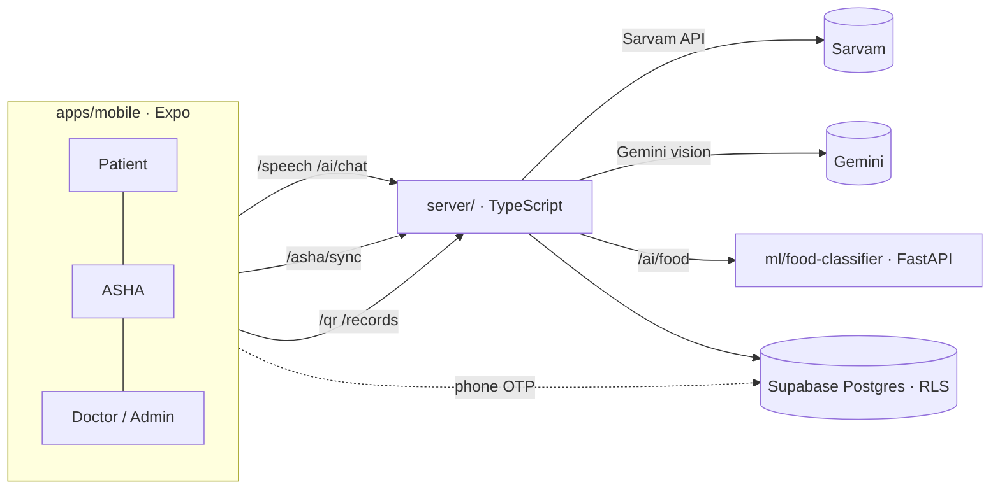

# Aroghya Mitra

One app for three people who rarely share a screen: the **patient** at home, the
**ASHA worker** walking between households, and the **doctor or admin** at the
primary health centre. Hindi, Kannada, Tamil, Telugu, Urdu, Kashmiri and
English; voice first; works offline in the field.

Built for a hackathon by a team of four (Mehdidar, sai-yogesh-git, thejas2401, Siddhanthsv),
joined into one Expo app, one TypeScript server and one Python
food-recognition service. A screening and care-coordination aid, never a
diagnosis: the 108 emergency button is on every patient screen.

```
                 ┌──────────────── apps/mobile (Expo, iOS + Android + web) ────────────────┐
                 │  (auth) language · role · OTP  │ (patient) │ (asha) │ (doctor / admin)  │
                 └───────────────┬────────────────┴─────┬─────┴───┬────┴─────────┬─────────┘
                                 │ @am/shared types, theme, i18n │ @am/patient-ai │ @am/records
                                 ▼                               ▼                ▼
               ┌──────────── server/ (TypeScript, web-standard handlers) ─────────────┐
               │ /speech/stt /speech/tts /ai/chat   Sarvam (key stays here)           │
               │ /ai/prescription  /ai/food         Gemini vision · DishDetect proxy  │
               │ /asha/sync /asha/photos            risk re-verified with server/risk │
               │ /qr/issue /qr/scan  /records/*     signed QR health card, history    │
               └───────┬───────────────────────────────────────────────┬──────────────┘
                       ▼                                               ▼
            supabase/migrations (Postgres + RLS)         ml/food-classifier (FastAPI, PyTorch)
```



## What is in the box

| Role | What they can do | Logic it runs on |
|---|---|---|
| Patient | Voice-first home with "tap to speak" and 108 · health assistant (chat and voice, streamed, grounded on approved summaries and the patient's own record) · **guided symptom check** (asks a few questions, then names possible causes and what to do) · prescription photo reader · medicine reminders with Taken / Skip, streak and adherence · food scan (DishDetect) · preventive care (vaccines, ANC, screenings) · PHC appointments · QR health card · find and message my ASHA · nearby hospitals and pharmacies on a map · blood banks · step counter | `packages/patient-ai` (red flags, symptom check, reminders, adherence, prevention), `server/ai`, `server/appointments`, `server/prevention` |
| ASHA worker | Caseload · register patient · home visit with vitals, symptoms, voice report and photos · automatic risk alerts · referrals · patient messages and visit requests · scan a patient's QR card · Today's plan · works offline, syncs later | `apps/mobile/features/asha` (35-rule risk engine); `server/asha` re-runs every rule and its verdict wins |
| Doctor | Referral inbox ranked by approved criteria · scan QR to open history · **AI copilot**: summary built only from the record, timeline, lab comparison, voice notes to an editable draft · prescribing with interaction, allergy, pregnancy and duplicate warnings, NLEM 2022 list, Jan Aushadhi generics · quick prescribe · day list of appointments | `server/copilot`, `packages/records`, `server/qr`, `server/records` |
| Admin | Staff · ASHA assignment board by village · blood stock · analytics · PHC hours | `packages/records`, `server/records` |

Everything the four modules share lives in `packages/shared`: the types, the
theme tokens, the language table and the **demo cast**, so the pregnant patient
with high blood pressure in Sunita's caseload (Rekha Kumari) is the same person
who signs in as the patient, whose QR the doctor scans, and whose referral sits
in Dr Rao's inbox.

## Setup

```bash
# Node 24+ and npm 11; Python 3.11+ only for the food model
npm install                       # installs the app, packages and server (npm workspaces)
cp .env.example .env              # server secrets: SARVAM_API_KEY, GEMINI_API_KEY, QR_TOKEN_SECRET
cp apps/mobile/.env.example apps/mobile/.env   # app settings (no keys in here, ever)

npm test                          # server + packages (node --test) and the app (jest-expo)
npm run typecheck                 # server/packages tsconfig + the app's
npm run ml:test                   # pytest for ml/food-classifier (needs its venv, see its README)
```

Optional: the food model. `ml/food-classifier/README.md` explains the data, the
trained heads and how to run the FastAPI service on port 8000; the server proxies
`/ai/food` to it (or to its Hugging Face Space), with a Sarvam image model as
backup. Nutrition numbers always come from `server/ai/food/dishCatalog.json`.
When neither is reachable the app says so; it never shows a sample dish.

## Run the demo

```bash
npm run demo          # server on the laptop's LAN IP + Expo Go QR code
npm run demo:web      # same, in the browser
```

The script prints the LAN URL, writes it into `apps/mobile/.env`, starts the
server (and the ML service if a venv exists) and Expo. Missing keys are listed
up front; each one degrades to a labelled demo path rather than an error.

**Demo logins** (role picker → one tap, or phone OTP with code `123456` when
Supabase is not configured):

| Role | Name | What they see |
|---|---|---|
| Patient | Rekha Kumari | 34 weeks pregnant, gestational hypertension, labetalol reminders, a referral in progress |
| ASHA | Sunita Devi | Six households in Rampur / Bhagwanpur / Sonpur, Rekha flagged critical |
| Doctor | Dr. Arjun Rao, PHC Hebbal | Rekha's referral pending, QR scan opens her history |
| Admin | Meena Shetty, PHC Hebbal | Staff, ASHA assignments, blood stock, analytics |

### Three-minute demo script

0. **Symptom check.** Patient → tap to speak: "Mujhe khansi hai" → it asks how long (tap a button), then about breathing, blood, fever… → possible causes and what to do. A short cough with a cold comes out as a common cold, not TB; a "yes" to breathing trouble shows the 108 banner.
1. **Patient, Kannada.** Pick Kannada → Patient → tap the voice orb: "ನನಗೆ ತಲೆನೋವು ಮತ್ತು ಕಣ್ಣು ಮಂಜಾಗುತ್ತಿದೆ" → the reply is spoken back; "chest pain" words would raise the red Call 108 banner.
2. **Prescription.** Home → Prescription → photo of a prescription → medicine cards, one field marked "Confirm with pharmacist" → Set reminders → Reminders tab shows today's doses; tap Taken.
3. **ASHA.** Sign out → ASHA → Rekha's card is critical (BP 150/100, headache, swelling) → open the visit → record a voice report in Hindi → Refer → the outbox shows "waiting to sync".
4. **Doctor.** Sign out → Doctor → referral inbox shows Rekha from Sunita → Scan QR (or "Use demo patient card") → history with the ASHA visit, vitals trend and adherence → New consultation → add a medicine → Save.
5. **Back to the patient.** Sign out → Patient → Reminders: the new medicine is there.

Records, reminders and ASHA visits work with no network and sync later. Speech,
chat, the symptom check's wording, prescription reading and food scans need the
server; without it the app says it cannot reach the service (no canned answers).
Sign-in is in demo mode (code `123456`) until phone sign-in is switched on in Supabase.

### Connecting the phones through Supabase

With a database, the three apps share data across separate phones: an ASHA
sync reaches the doctor's inbox, the doctor's prescription reaches the
patient's Reminders, and the patient's dose taps reach the record. Each phone
still works offline and sends its changes later (`features/shared/data/outbox.ts`).

1. In the repo-root `.env`: `SUPABASE_URL`, `SUPABASE_SERVICE_ROLE_KEY`,
   `DATABASE_URL`, and `AUTH_MODE=demo` while phone sign-in is off.
2. `npm run db:migrate` applies `supabase/migrations` (safe to repeat).
3. `npm run db:seed` creates the four demo users and Rekha's records (safe to repeat).
4. `npm run db:check` confirms every table, then restart the server.

Without these the server keeps records in memory, which is enough for a
one-laptop demo.

### Phones and hosting

```bash
npm run deploy:server -- --yes   # server → Supabase Edge Function "api"
npm run deploy:food -- --local   # food model → container / Hugging Face Space
```

- **iPhone or Android, quickest:** open the `preview` EAS Update in Expo Go
  (signed in to the project's Expo account). No Mac or Apple fee needed.
- **Android app file:** build an APK from the `preview` EAS build profile.
- Publish from a clean git worktree of committed code only.

## Repository

```
apps/mobile/            Expo app (SDK 58, Expo Router): app/(auth) (patient) (asha) (doctor), features/, locales/ (7 languages)
packages/shared/        types, theme tokens, language table, demo cast, ids                         (@am/shared)
packages/patient-ai/    red flags, guided symptom check, reminders, adherence, prevention, generics (@am/patient-ai)
packages/records/       QR card, referral inbox ranking, medicines and warnings, blood banks       (@am/records)
server/                 one router: speech + chat (Sarvam), symptom check, prescription/food AI, copilot,
                        ASHA sync, QR, records, appointments, prevention, places, integrations (ABDM sandbox)
supabase/migrations/    1000 base · 3001–3002 ASHA · 4001–4003 records/QR/reports · 5001 labs · 5101 preventive
                        · 5201 appointments · 5301 ASHA connect; RLS test in supabase/tests
ml/food-classifier/     DishDetect India: CLIP probe + MobileNet heads, FastAPI /ai/food
docs/                   STATUS · CLINICAL_REVIEW · DEVICE_TEST · INT

